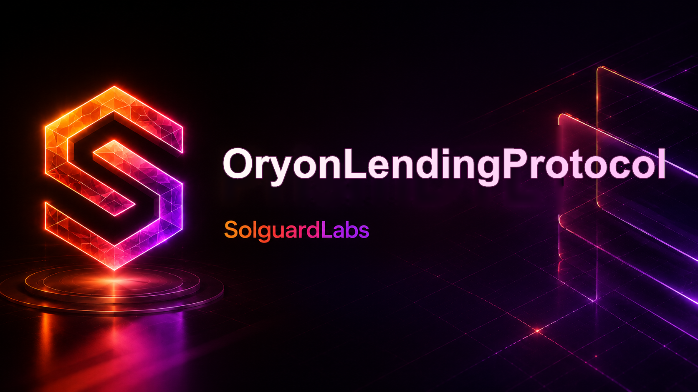

# OryonLendingProtocol



OryonLendingProtocol es un mercado de lending multiactivo escrito en Vyper. El
protocolo permite aportar liquidez, usar activos admitidos como colateral, abrir
deuda variable, repagar posiciones y liquidar cuentas que dejan de cumplir los
umbrales de riesgo.

El repositorio esta preparado para auditoria local con Python, Vyper 0.4.3,
titanoboa y pytest.

## Componentes

```text
src/
  OryonLendingPool.vy          Pool principal, mercados, deuda e indices
  OryonOracle.vy               Oraculo local con reporteros y vigencia
  OryonRateModel.vy            Curva variable de dos pendientes
  OryonProtocolLens.vy         Vistas agregadas para integradores
  OryonRiskRegistry.vy         Registro de perfiles de riesgo
  OryonInterestLens.vy         Proyecciones de tipos e indices
  OryonLiquidationPlanner.vy   Planificacion operativa de liquidaciones
  OryonReserveVault.vy         Gestion auxiliar de reservas
  OryonExposureJournal.vy      Journal operativo de flujos
  OryonAccountingReconciler.vy Reconciliacion de snapshots
  OryonGovernanceQueue.vy      Cola de cambios parametrizados
  OryonScenarioSimulator.vy    Simulaciones puras de escenarios
  MockERC20.vy                 Token ERC20 local para pruebas
```

## Modelo operativo

Cada activo listado mantiene limites de supply y borrow, factor de colateral,
umbral de liquidacion, incentivo, close factor, factor de reserva y parametros
de tipo variable. Las operaciones que dependen de deuda actualizan el indice del
mercado antes de modificar saldos.

Los usuarios aportan activos al pool y reciben un saldo interno de colateral. Si
la posicion tiene capacidad disponible, puede abrir deuda sobre cualquier activo
borrow-enabled con liquidez suficiente. La deuda se representa como principal en
el ultimo indice observado por la cuenta.

Cuando una posicion baja del umbral de liquidacion, un keeper puede repagar una
parte de la deuda y recibir colateral transferido desde el pool. El close factor
limita el tamano de una liquidacion individual.

## Requisitos

- Python 3.13 recomendado.
- pip.
- Entorno Bash o PowerShell para los scripts.

## Instalacion

```bash
python -m venv .venv
source .venv/bin/activate
python -m pip install -e ".[dev]"
```

En PowerShell:

```powershell
python -m venv .venv
.\.venv\Scripts\Activate.ps1
python -m pip install -e ".[dev]"
```

## Pruebas

```bash
python -m pytest -q
```

La suite cubre:

- supply y actualizacion de liquidez;
- borrow y registro de deuda variable;
- repay parcial;
- accrual de indices de borrow y supply;
- liquidacion parcial con transferencia de colateral.

## Validacion completa

```bash
bash scripts/ci.sh
```

En PowerShell:

```powershell
.\scripts\ci.ps1
```

El flujo compila todos los contratos Vyper, valida que `src/` permanezca entre
3.000 y 4.000 LOC y ejecuta la suite de pytest.

## Seguridad operativa

Antes de listar un activo se deben revisar precio, decimales, liquidez externa,
profundidad de mercado, caps, curva de tipos, factor de reserva y parametros de
liquidacion. Los cambios de riesgo deben pasar por una cola de gobernanza o un
proceso equivalente con revision separada.

## Licencia

MIT. Consulte [LICENSE](./LICENSE).
