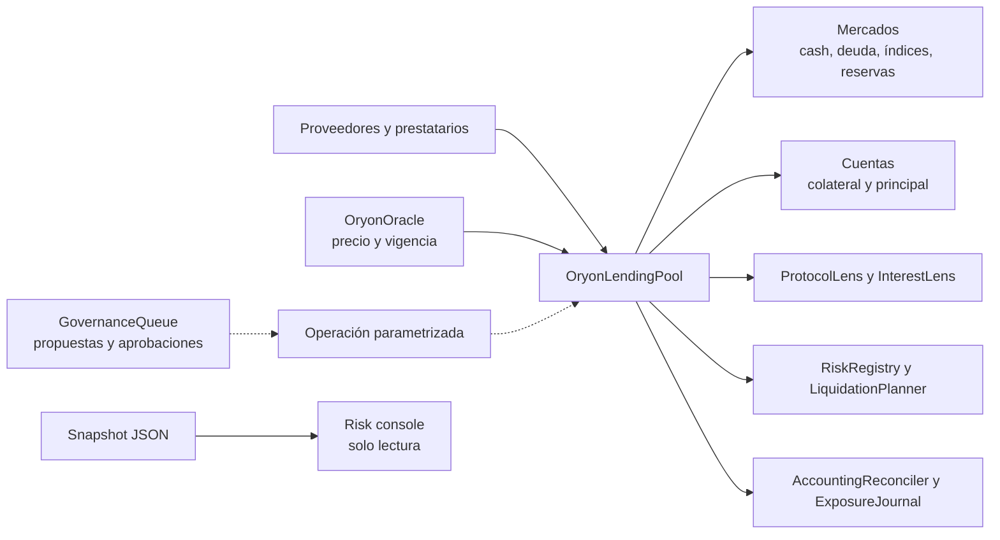

# OryonLendingProtocol


Mercado multiactivo de crédito variable en Vyper. Oryon reúne provisión de
liquidez, posiciones con colateral, deuda indexada, parámetros de riesgo por
activo y liquidación de cuentas por debajo del umbral. El repositorio contiene
contratos, utilidades de observación y una consola local de análisis de
carteras; no incluye claves ni configuración de red externa.

## Arquitectura



`OryonLendingPool.vy` es la fuente de estado de los saldos. Los módulos de
observación y planificación no reemplazan sus verificaciones. La cola de
gobernanza registra y marca propuestas aprobadas; la aplicación de cambios en
el pool sigue siendo una operación separada del propietario.

## Modelo económico

Los importes de tokens se expresan en unidades mínimas dentro de los contratos.
Cada activo tiene `unit = 10^decimals` y precio USD con escala `1e18`.

```text
valor_USD(asset, amount) = amount × precio_e18 / unit
utilización             = deuda_total / (cash + deuda_total)
deuda_cuenta_actual     = principal × índice_borrow_actual / índice_snapshot
capacidad_colateral     = Σ valor_USD(colateral) × factor_colateral
factor_salud            = Σ valor_USD(colateral) × umbral_liquidación / Σ valor_USD(deuda)
```

Todas las divisiones on-chain son enteras. El tipo variable usa una curva de
dos tramos: hasta `kink` crece con `slope1` y, por encima, con `slope2`. Los
intereses actualizan deuda e índices; `reserve_factor` separa la porción
destinada a reservas. `supply_cap`, `borrow_cap`, banderas por mercado y
`close_factor` acotan las operaciones correspondientes.

Ejemplo: 10 WETH a 2.000 USD con factor de colateral 0,72 aportan 14.400 USD
de capacidad. Una deuda de 12.000 USDC deja 2.400 USD de margen de préstamo;
con umbral de liquidación 0,80, el factor de salud inicial es 1,3333.

Más detalle: [arquitectura](docs/arquitectura.md),
[modelo económico](docs/modelo-economico.md),
[integración](docs/integracion.md),
[operación](docs/operacion.md) y [riesgo](docs/riesgo.md).

## Inicio local

Requiere Python 3.13, `pip` y un entorno compatible con Vyper 0.4.3.

```bash
python -m venv .venv
source .venv/bin/activate
python -m pip install -e ".[dev]"
python scripts/compile_contracts.py
python -m pytest -q
```

En PowerShell active `.venv\Scripts\Activate.ps1` o llame directamente a
`.venv\Scripts\python.exe`. Para la validación completa:

```bash
bash scripts/ci.sh
```

El script instala dependencias, compila todos los contratos, comprueba el
presupuesto de código Vyper y ejecuta pytest. `scripts/tests.sh` ejecuta la
suite sobre un entorno ya preparado. La CI repite la validación en GitHub
Actions para PR, `main`, `production` y etiquetas estables.

## Consola de riesgo

La consola procesa un snapshot exportado sin conectarse a una cadena ni
firmar transacciones. Trabaja con cantidades decimales de tokens, no con
unidades mínimas, y devuelve estimaciones: no constituye una cotización
on-chain ni sustituye una lectura fresca de oráculo.

```bash
python -m client.risk_console tests/fixtures/portfolio.json --days 30 --shock WETH=0.70
```

El informe incluye utilización, APR de borrow y supply, proyección lineal de
reservas, capacidad de préstamo, colchón de liquidación y factor de salud
actual y tensionado. Los decimales se serializan como cadenas para no perder
precisión en consumidores JSON.

## Superficie del repositorio

| Ruta | Función |
| --- | --- |
| `src/OryonLendingPool.vy` | Estado de mercados y cuentas, operaciones de crédito |
| `src/OryonOracle.vy` | Precios, reporteros y caducidad |
| `src/OryonRateModel.vy` | Curva de tipos reutilizable |
| `src/OryonProtocolLens.vy` | Consultas agregadas |
| `src/OryonLiquidationPlanner.vy` | Políticas y planes de keeper |
| `src/OryonAccountingReconciler.vy` | Checkpoints de conciliación |
| `client/risk_console.py` | Proyecciones locales de solo lectura |
| `tests/` | Flujos de contrato y consola |

## Publicación y seguridad

`Production 1.0.0` identifica el estado versionado del repositorio, no un
despliegue en una red con fondos. La rama `production` y la etiqueta anotada
`v1.0.0` deben apuntar al mismo commit que `main`; el release se publica solo
tras comprobar CI. Revise [SECURITY.md](SECURITY.md) antes de integrar los
contratos en otro sistema. Licencia MIT en [LICENSE](LICENSE).
