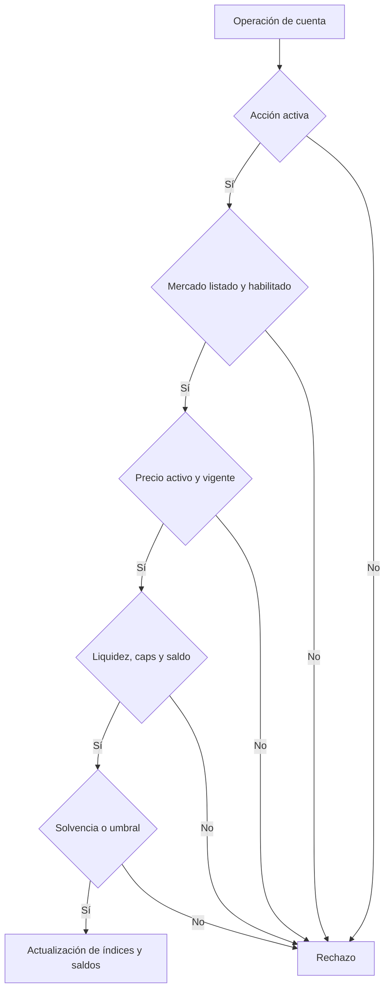

# Política de seguridad

Oryon separa autorización, precios, solvencia y contabilidad. Los controles
descritos aquí son los que deben verificarse al revisar cambios; la presencia
de una prueba automatizada no equivale a una auditoría externa.

## Límites y confianza

El propietario puede listar activos, modificar parámetros de mercado y pausar
acciones. El oráculo acepta reporteros configurados por activo y rechaza
precios no vigentes. Las cuentas no pueden retirar o tomar deuda si la
operación incumple la solvencia calculada por el pool. Las liquidaciones
requieren factor de salud inferior a uno y respetan la fracción de cierre de
la deuda. Los contratos auxiliares solo tienen las capacidades expresas de
sus interfaces; una propuesta en cola no ejecuta automáticamente un cambio
de parámetros.

## Propiedades de revisión

| Área | Propiedad observable | Verificación |
| --- | --- | --- |
| Mercado | Supply y borrow no superan sus caps | Tests de flujos y revisión de parámetros |
| Crédito | La deuda de cuenta escala con el índice | Tests de accrual con avance temporal |
| Tesorería | Cash, deuda y reservas se concilian | Snapshots y reconciliador |
| Oráculo | La lectura rechaza precio inactivo o caducado | Tests del oráculo y controles operativos |
| Cuenta | Retirar o tomar deuda preserva solvencia | Pruebas de cuenta y escenarios de estrés |
| Operación | Pausa y permisos son explícitos | Revisión de eventos y roles |

La consola `client/risk_console.py` valida esquema, ratios, referencias a
mercados y valores finitos. Sus proyecciones son orientativas porque un
snapshot puede quedar obsoleto y porque el cálculo on-chain usa enteros.

## Dependencias y cambios

La CI compila todos los contratos Vyper y ejecuta pytest en cada PR y push.
Dependabot revisa dependencias Python y GitHub Actions semanalmente. Los
cambios de parámetros deben adjuntar motivo, impacto sobre posiciones,
ventana de ejecución y plan de reversión antes de aplicarse. Antes de usar un
artefacto versionado, verifique el commit de `main`, `production` y el objeto
de la etiqueta anotada, además de los checks del release.

## Reporte coordinado

Use un canal privado de reporte de seguridad de GitHub si está habilitado para
el repositorio. Incluya versión y commit, precondiciones, pasos mínimos,
comportamiento esperado y observado, efecto económico y trazas locales. No
incluya claves reales ni publique detalles técnicos en una issue abierta
antes de coordinar la revisión.

Este repositorio y sus pruebas locales no acreditan un despliegue on-chain ni
la custodia de activos de terceros.
