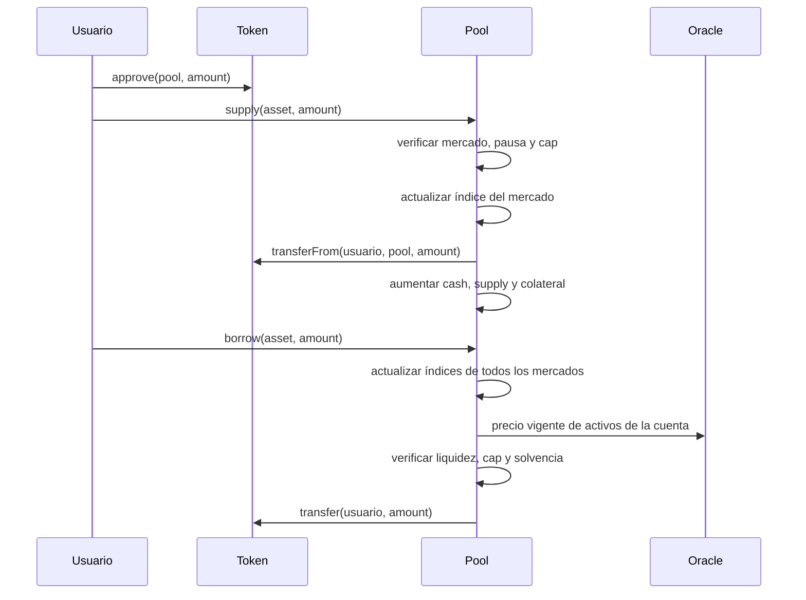

# Arquitectura de Oryon

## Responsabilidades

El pool concentra saldos, índices, límites y operaciones que cambian estado.
El oráculo publica precios con `updated_at`, ventana de vigencia, reportero y
bandera de actividad. Los módulos `Lens` ofrecen vistas; `RiskRegistry`
organiza perfiles; `LiquidationPlanner` almacena políticas y planes; y el
reconciliador conserva checkpoints de mercados y cuentas. Estos auxiliares no
son una segunda fuente de verdad del balance del pool.

`supply` y `repay` actualizan el mercado afectado. `borrow`, `withdraw` y
`liquidate` actualizan todos los mercados listados antes de comprobar el
estado de cuenta. El límite de 16 activos acota el recorrido on-chain.

## Frontera entre planificación y ejecución

Un keeper puede usar el planificador para registrar rutas con importes y
ventanas. La autorización para planificar no es autorización para cambiar
los parámetros del pool. La operación ejecutada siempre vuelve a pasar por
las verificaciones de `OryonLendingPool.vy` y el estado actual del oráculo.

`GovernanceQueue` registra propuestas con `eta`, expiración, aprobaciones y
estado. `mark_executed` documenta una decisión lista; el contrato no invoca
automáticamente el destino de la propuesta. Un operador debe comprobar
separadamente la transacción que aplica el cambio y conservar su referencia.

## Lecturas operativas

`market_snapshot(asset)` devuelve cash, supply, borrows, reserves e índices.
`account_values(account)` devuelve colateral ponderado, deuda valorada y
liquidez residual. `health_factor(account)` usa los umbrales de liquidación.
Las lecturas son puntuales: no equivalen a una simulación de transacción
futura, especialmente si cambian tiempo, precios o liquidez.
