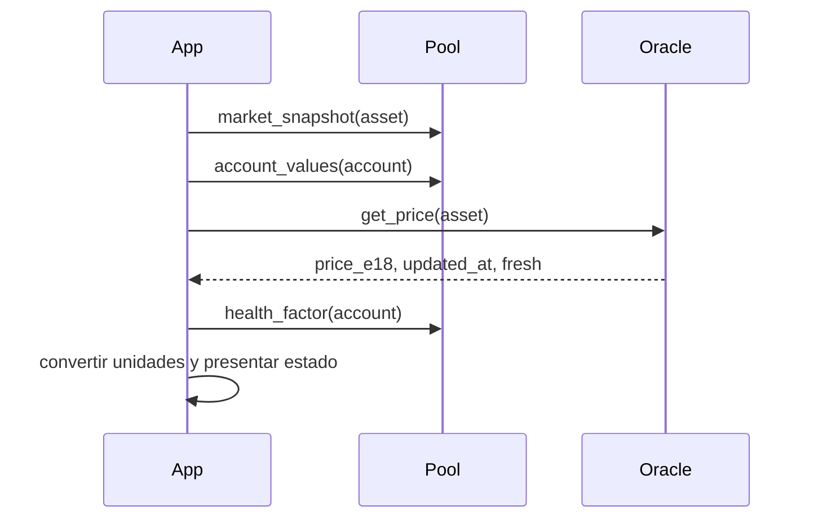

# Integración local

## Compilación y pruebas

Use Python 3.13 y dependencias definidas en `pyproject.toml`:

```bash
python -m venv .venv
source .venv/bin/activate
python -m pip install -e ".[dev]"
bash scripts/ci.sh
```

En Windows con PowerShell, use `.venv\Scripts\python.exe` para invocar
`scripts/compile_contracts.py` y `-m pytest -q` si no dispone de Bash. El
script `ci.sh` requiere un Bash compatible. La ejecución local no necesita
RPC externo ni claves.

## Lecturas y escritura

Para mostrar una posición consulte `debt_of`, `collateral_balance`,
`account_values` y `health_factor` sobre un mismo bloque cuando sea posible.
El precio procede de `OryonOracle.get_price`, que devuelve además marca
temporal y estado de vigencia. Antes de `borrow` o `withdraw`, trate los
resultados de vistas como estimaciones, pues la transacción actualiza índices
y vuelve a comprobar solvencia.



Un cliente que envíe transacciones debe considerar aprobación ERC20,
decimales, pausas y caps. No use la salida de la consola local para fijar
importe de ejecución sin recalcular el estado on-chain.

## Snapshot para la consola

`tests/fixtures/portfolio.json` es un ejemplo versionado. Contiene `markets`
indexados por símbolo y `positions` por símbolo. Los importes se pasan como
cadenas decimales en unidades legibles de token. Precios en USD por token;
factores y tasas como ratios entre cero y uno cuando corresponda.

```bash
python -m client.risk_console tests/fixtures/portfolio.json --days 30 --shock WETH=0.70
```

`--shock WETH=0.70` conserva el 70 % del precio base de WETH; se pueden
añadir varios shocks. El informe serializa números como cadenas con ocho
decimales. Las reservas proyectadas suponen saldos y tasa constantes durante
el horizonte indicado; no modelan repagos, nuevas deudas ni composición.
