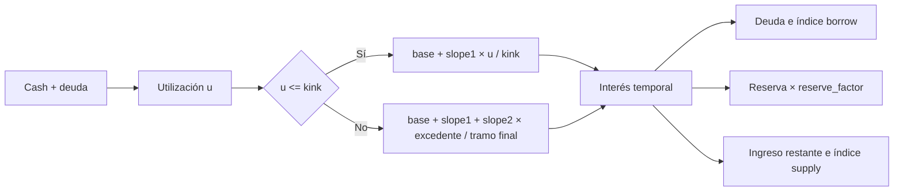

# Modelo económico

## Escalas y valor

El precio de cada activo se expresa en USD con 18 decimales. La cantidad de
token usa sus decimales propios. El pool obtiene el valor como
`amount × price_e18 // 10^decimals`. Los factores de colateral, umbrales,
reservas y ratios de tipos usan escala `1e18`. Al interpretar eventos o
snapshots, convierta cada cantidad con el `unit` del activo correspondiente.

| Magnitud | Unidad | Ejemplo |
| --- | --- | --- |
| USDC `amount` | 1e6 | `12_000_000_000` = 12.000 USDC |
| WETH `amount` | 1e18 | `10e18` = 10 WETH |
| `price_e18` | USD × 1e18 | `2_000e18` = 2.000 USD |
| `borrow_index` | ratio × 1e18 | `1e18` al listar |

## Índices y curva



El pool calcula primero la tasa anual por tramos y la trunca a tasa por
segundo. Después actualiza `total_borrows`, `total_reserves` y los índices.
Una deuda individual se normaliza al índice de su último cambio de saldo:

```text
deuda_actual = principal_guardado × índice_actual // índice_snapshot
interés      = deuda_total × tasa_por_segundo × segundos // 1e18
reserva      = interés × reserve_factor // 1e18
```

La consola de riesgo usa aritmética decimal sin ese truncamiento para
proyecciones lineales; por ello puede diferir algunos enteros de la cadena.

Ejemplo de curva: con cash 880.000 USDC y deuda 120.000 USDC, `u=0,12`.
Si `base=0`, `slope1=0,20` y `kink=0,80`, el APR de borrow es 0,03. Con
`reserve_factor=0,10`, el APR indicativo de supply es
`0,03 × 0,12 × 0,90 = 0,00324`. Sobre 120.000 USDC de deuda, la reserva
lineal anual estimada es 360 USDC si los saldos no cambian.

## Riesgo de cuenta

La capacidad de préstamo suma el valor de cada colateral multiplicado por
su factor de colateral. Para evaluar salud se sustituye ese factor por el
umbral de liquidación. La deuda se valora sin descuento. Si no hay deuda, el
pool devuelve el máximo `uint256` como factor de salud; la consola devuelve
`null` para representar que el ratio no está definido.

El valor de la cuenta depende de precios vigentes y de los índices que se
actualicen antes de la operación. La planificación debe reservar margen
para volatilidad, tiempo transcurrido y redondeo entero.
