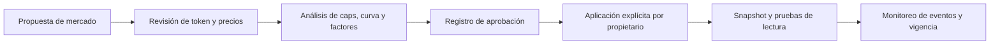

# Operación y cambios

## Alta de mercado

Antes de llamar a `list_asset`, verifique dirección y decimales del token,
reportero del oráculo, ventana de vigencia y precio inicial. Documente caps,
factores de colateral, umbral, incentivo, close factor, curva de tipos y
reserva. La función rechaza un mercado duplicado, más de 16 activos,
decimales superiores a 18 y varios parámetros fuera de rango.

La cola de gobernanza no transmite automáticamente los parámetros al pool.
Registre la transacción de aplicación y contraste el estado final del pool.

## Monitoreo

Observe eventos `AssetListed`, `MarketUpdated`, `Supplied`, `Withdrawn`,
`Borrowed`, `Repaid`, `Liquidated` y `PauseSet`. Para cada mercado concilie
saldo ERC20 del pool, `cash`, deuda, supply y reservas; registre diferencias
con bloque y timestamp. Un checkpoint del reconciliador es una observación,
no una reparación del estado. Recalcule el estado tras cambios de oráculo o
periodos largos sin accrual.

## Incidentes y pausas

Si se detecta una condición operativa anómala, capture bloque, precios,
snapshots y eventos antes de intervenir. Determine la acción afectada y
evalúe `set_pause` para ella; la pausa es granular, por lo que debe
comprobarse su efecto concreto. Revise dependencias de liquidación y repago
antes de restringirlas. Los cambios de parámetros requieren una revisión
separada del impacto sobre cuentas abiertas.

## Publicación

Una etiqueta estable debe referenciar un commit verificable, con CI verde y
release no borrador. Compare explícitamente `main`, `production` y la
resolución de `v1.0.0^{}`. No infiera de una release de código que exista
despliegue en una red o que sus parámetros coincidan con una instancia
externa.
