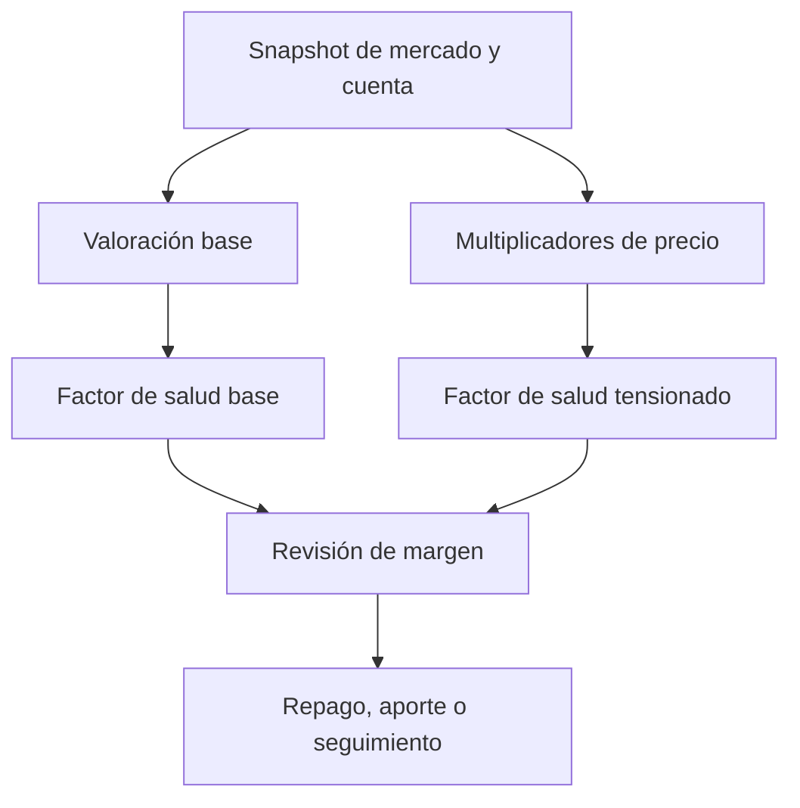

# Modelo de riesgo

## Fuentes de variación

La liquidez disponible, la deuda indexada, el precio y los parámetros de
mercado pueden cambiar entre una consulta y la inclusión de una transacción.
Las interfaces deben mostrar bloque de referencia y estado del precio, y
tratar los cálculos locales como estimaciones. En particular, una variación
del precio de un colateral reduce capacidad de préstamo y factor de salud
simultáneamente, aunque la deuda nominal no cambie.

| Factor | Señal | Respuesta operativa |
| --- | --- | --- |
| Precio caducado | `fresh = false` en oráculo | Detener decisiones dependientes de precio |
| Utilización elevada | deuda / (cash + deuda) | Revisar liquidez y tramo de la curva |
| Salud próxima a uno | margen de liquidación pequeño | Reducir deuda o aportar colateral |
| Cap cercano | supply o borrow frente a límite | Revisar alta de posiciones nuevas |
| Desfase de snapshot | bloque o tiempo antiguo | Releer antes de ejecutar |

## Escenarios de cartera

La consola de riesgo lee un snapshot y aplica multiplicadores por activo.
Para una posición de 10 WETH y 12.000 USDC de deuda, con WETH a 2.000 USD
y umbral 0,80, la capacidad de liquidación es 16.000 USD. Si WETH baja al
70 % de ese precio, pasa a 11.200 USD y el colchón frente a la deuda es
-800 USD. El escenario identifica exposición, no afirma que una
transacción pueda ejecutarse al precio observado.

## Límites del modelo

La proyección de reservas es lineal y mantiene cash, deuda y tasa constantes.
No incorpora distribución de precios, correlaciones, cambios de parámetros,
slippage, coste de liquidación ni cambios de deuda durante el horizonte.
Los cálculos decimales de la consola no reproducen exactamente el truncamiento
de enteros del contrato. Para decisiones de ejecución use lecturas on-chain
actuales y simulación de la transacción completa.
